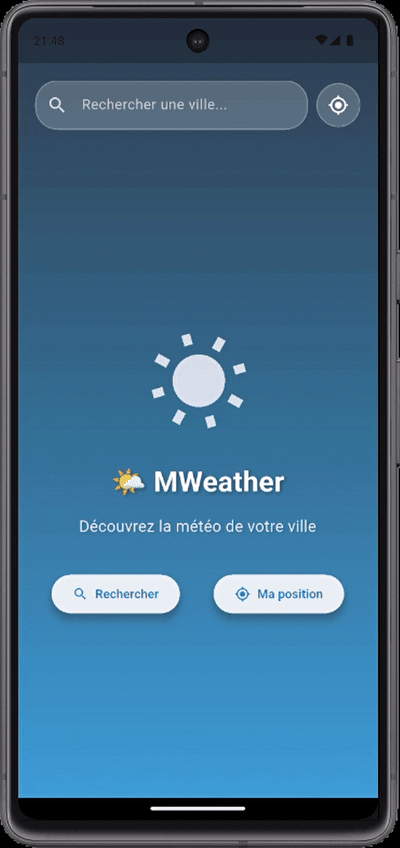

# MWeather - Flutter Weather App

MWeather is an elegant and intuitive weather application built with Flutter. It allows users to check real-time weather conditions for any city in the world, as well as for their current location.



## Features

**City Search**: Search weather for any city in the world.
**Geolocation**: Get weather for your current location
**Detailed Data**: Temperature, humidity, wind speed, atmospheric pressure, visibility
**Modern Interface**: Elegant design with color gradients that change according to the time of day
**Responsive**: Works on all mobile devices
**Adaptive Theme**: Interface that automatically adapts to day and night

## Technologies Used

**Flutter**: Cross-platform development framework
**Dart**: Programming language
**Provider**: State management
**Dio**: HTTP client for API calls
**Geolocator**: GPS position retrieval
**OpenWeatherMap API**: Source of weather data

## Installation

1. Clone the repository:

   ```bash
   git clone https://github.com/asvpxvivien/mweather.git
   ```

2. Navigate to the project folder:

   ```bash
   cd mweather
   ```

3. Install dependencies:

   ```bash
   flutter pub get
   ```

4. Run the application:
   ```bash
   flutter run
   ```

## Configuration

The app uses the OpenWeatherMap API. The API key is already included in the code, but you can modify it in [lib/services/weather_service.dart]

```dart
static const String _apiKey = 'YOUR_API_KEY_HERE';
```
